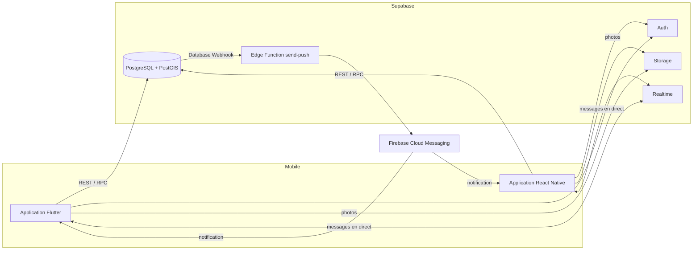

# DarImmo

Application mobile de services immobiliers pour la Tunisie : recherche, consultation et publication d'annonces de vente et de location, avec messagerie en temps réel entre acheteurs et annonceurs.

Le projet est développé en deux versions, **Flutter** et **React Native**, qui partagent un backend unique **Supabase** (PostgreSQL + PostGIS, Auth, Storage, Realtime, Edge Functions). Les notifications push passent par **Firebase Cloud Messaging**.

> Projet de fin d'année — DSI2, ISET. Équipe de trois étudiants, organisation Scrum sur Jira (clé `IMM`, sprints 0 à 7).

---

## Sommaire

- [Fonctionnalités](#fonctionnalités)
- [Architecture](#architecture)
- [Contenu du dépôt](#contenu-du-dépôt)
- [Avancement](#avancement)
- [Installation](#installation)
- [Maquettes](#maquettes)
- [Équipe](#équipe)
- [Conventions](#conventions)
- [Crédits](#crédits)

---

## Fonctionnalités

| Module | Fonctionnalités principales | Epic |
|---|---|---|
| Authentification et profil | Inscription par email, connexion, réinitialisation du mot de passe, modification du profil et de la photo | 2 |
| Recherche et consultation | Liste paginée, filtres (prix, ville, type, offre, pièces), détail d'une annonce, signalement | 3 |
| Carte | Annonces sur la carte, recherche « autour de moi » (PostGIS) | 4 |
| Favoris | Ajout et suppression de favoris | 5 |
| Publication | Formulaire d'annonce, jusqu'à 10 photos, position sur la carte, suivi du statut de validation | 6 |
| Messagerie | Conversation liée à une annonce, échanges en temps réel, liste des conversations | 7 |
| Notifications | Push à la réception d'un message et au changement de statut d'une annonce | 8 |
| Administration | Validation ou rejet des annonces avec motif, traitement des signalements, blocage de comptes | 9 |

Cycle de vie d'une annonce :

```
brouillon ──► en_attente ──(admin)──► publiee ──► vendue / louee
                 ▲   │                   │
                 │   └──(admin, motif)──► rejetee
                 └────── renvoi ─────────┘
publiee modifiée par l'annonceur ──► en_attente
admin : publiee ──► masquee (après signalement)
```

---

## Architecture



- **Sécurité** : Row Level Security activée sur toutes les tables. Un utilisateur ne voit que les annonces publiées, ses propres annonces et ses propres conversations.
- **Logique métier côté base** : les triggers gèrent la création du profil, le calcul de la position géographique, les transitions de statut et la date du dernier message. Les fonctions RPC couvrent l'ouverture d'une conversation, la recherche par rayon et la remise en ordre des photos.
- **Temps réel** : abonnement `postgres_changes` sur la table `messages`, filtré par conversation.
- **Push** : un webhook sur `messages` (INSERT) et `annonces` (UPDATE) appelle l'Edge Function `send-push`, qui envoie la notification via l'API FCM v1.

---

## Contenu du dépôt

```
projet_3eme/
├── supabase/                 Base de données et backend
│   ├── 00_reset.sql          Remise à zéro (projet de test uniquement)
│   ├── 01_schema.sql         Types énumérés, 9 tables, contraintes, index
│   ├── 02_fonctions.sql      Triggers et fonctions RPC
│   ├── 03_rls.sql            Règles de sécurité
│   ├── 04_storage_realtime.sql  Buckets et publication Realtime
│   ├── 05_seed.sql           Données de test
│   ├── functions/send-push/  Edge Function d'envoi des notifications
│   └── README.md             Guide d'installation et référence des appels
├── poc_temps_reel/           Preuve de concept Flutter (chat temps réel + push)
├── design/                   Maquettes de l'application
│   ├── maquettes_darimmo.html   Aperçu des 23 écrans dans le navigateur
│   ├── figma-plugin/         Plugin Figma qui génère les maquettes
│   ├── src/                  Description des écrans et moteurs de rendu
│   └── build.py              Génère la page HTML et le plugin
└── docs/                     Dossier de conception (C4) et backlog Jira
```

---

## Avancement

**Sprint 0 — Conception et mise en place**

| Ticket | Description | Responsable | État |
|---|---|---|---|
| 1.3 | Schéma de base de données, script SQL et données de test | Membre C | Terminé |
| 1.4c | Maquettes : publication, mes annonces, messagerie | Membre C | Terminé |
| 1.7 | Projet Firebase et preuve de concept temps réel / push | Membre C | En cours : chat validé sur le web, push à valider sur Android |

Les maquettes couvrent également les écrans des tickets 1.4a et 1.4b afin de garder une identité visuelle commune.

---

## Installation

### Prérequis

- Flutter 3.47 ou plus récent (SDK Dart ^3.13)
- Un projet [Supabase](https://supabase.com) (région Europe conseillée)
- Pour Android : Android Studio, un émulateur avec Google Play et un projet Firebase
- Python 3 avec Pillow, uniquement pour régénérer les maquettes

### 1. Base de données

Dans le **SQL Editor** de Supabase, exécuter dans l'ordre `01_schema.sql`, `02_fonctions.sql`, `03_rls.sql` et `04_storage_realtime.sql`. Créer ensuite les comptes de test, puis exécuter `05_seed.sql`.

Le détail (comptes, vérifications, tests de sécurité) se trouve dans [`supabase/README.md`](supabase/README.md).

### 2. Preuve de concept Flutter

```bash
cd poc_temps_reel
cp env.example.json env.json      # puis renseigner l'URL du projet et la clé publishable
flutter pub get
flutter run -d chrome --dart-define-from-file=env.json
```

Sous Windows PowerShell, remplacer `cp` par `Copy-Item`.

Pour Android, placer le fichier `google-services.json` du projet Firebase dans `android/app/`, puis lancer `flutter run` sur un émulateur. Les fichiers `env.json` et `google-services.json` ne sont pas versionnés.

**Comptes de test**

| Rôle | Email | Mot de passe |
|---|---|---|
| Administrateur | `admin@darimmo.test` | `Test1234!` |
| Annonceur | `vendeur@darimmo.test` | `Test1234!` |
| Acheteur | `acheteur@darimmo.test` | `Test1234!` |

Pour tester le chat, ouvrir l'application dans une fenêtre normale (acheteur) et dans une fenêtre de navigation privée (annonceur), puis échanger des messages dans la même conversation.

### 3. Notifications push

```bash
supabase functions deploy send-push --no-verify-jwt
supabase secrets set FCM_SERVICE_ACCOUNT="$(cat service-account.json)" WEBHOOK_SECRET=<valeur>
```

Créer ensuite deux **Database Webhooks** vers la fonction (`messages` sur INSERT, `annonces` sur UPDATE), avec l'en-tête `x-webhook-secret`. La clé du compte de service Firebase ne doit jamais être ajoutée au dépôt.

---

## Maquettes

Les 23 écrans de l'application et le design system sont visibles dans `design/maquettes_darimmo.html`. La page propose un filtre par membre, un aperçu en mode sombre et trois niveaux de zoom.

**Import dans Figma** (application Figma Desktop) :

1. *Plugins → Development → Import plugin from manifest…*, puis choisir `design/figma-plugin/manifest.json`.
2. *Plugins → Development → DarImmo Maquettes*.

Le plugin crée une page contenant les écrans en auto-layout, rangés par membre, ainsi que les couleurs sous forme de variables (modes Clair et Sombre).

Pour modifier un écran, éditer `design/src/spec.js` puis exécuter :

```bash
python design/build.py
```

La page HTML et le plugin sont régénérés à partir de la même description, ce qui garantit qu'ils restent identiques.

---

## Équipe

| Membre | Rôle | Périmètre |
|---|---|---|
| A | Scrum Master, backend | Authentification, profil, administration, configuration Supabase, dépôts et squelettes |
| B | Product Owner | Recherche, filtres, détail, carte, favoris, signalement |
| C | Tech Lead base de données | Schéma SQL et sécurité, publication d'annonces, messagerie, notifications |

Chaque fonctionnalité est développée dans les deux versions (Flutter et React Native) au cours du même sprint.

---

## Conventions

- **Branches** : `main` et `develop` protégées ; une branche par ticket et par version, par exemple `feature/IMM-12-login-flutter` et `feature/IMM-12-login-rn`.
- **Commits** : clé du ticket Jira en préfixe, par exemple `IMM-12: ajout écran de connexion`.
- **Revue de code** : chaque pull request est relue par un autre membre (A relit B, B relit C, C relit A).
- **Secrets** : les clés sont lues depuis `env.json` (non versionné) ; seul `env.example.json` est présent dans le dépôt.
- **Architecture des applications** : un dossier par module (`features/auth`, `features/search`, `features/publish`, `features/chat`…), Provider et go_router côté Flutter, Zustand et React Navigation côté React Native.

---

## Crédits

- Photographies des maquettes : [Unsplash](https://unsplash.com) (licence Unsplash).
- Icônes : tracés inspirés de [Lucide](https://lucide.dev) (licence ISC).
- Police : Plus Jakarta Sans (SIL Open Font License).

Projet réalisé dans un cadre pédagogique à l'ISET.
